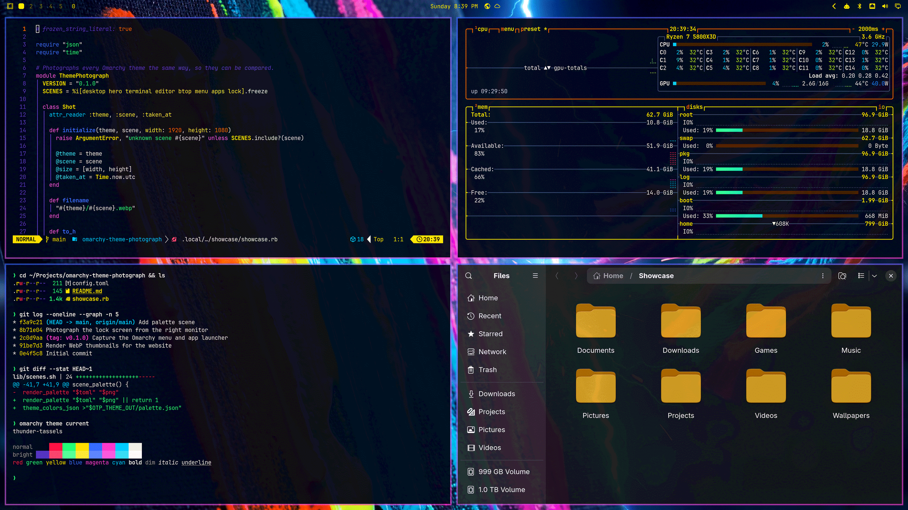
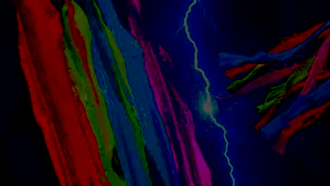
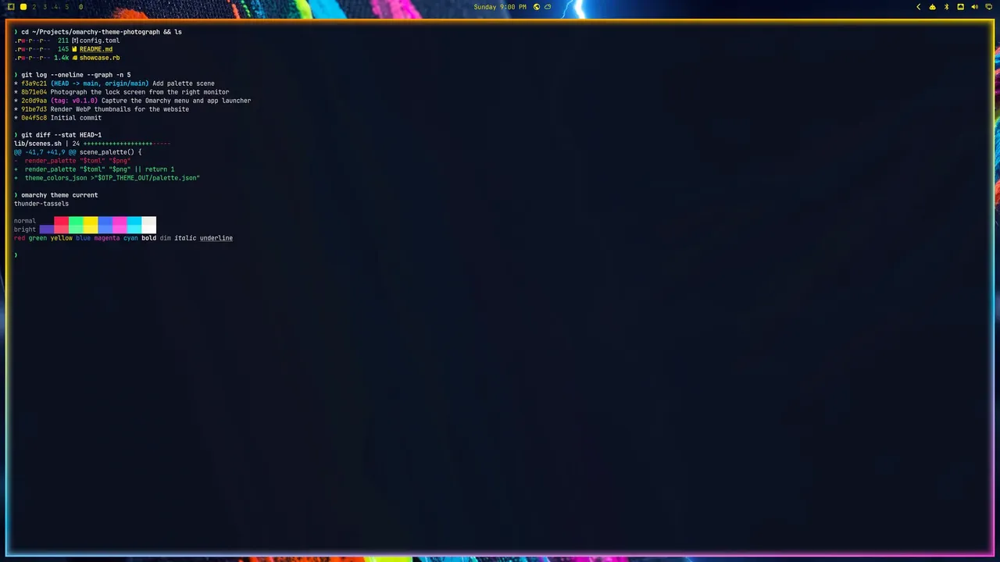
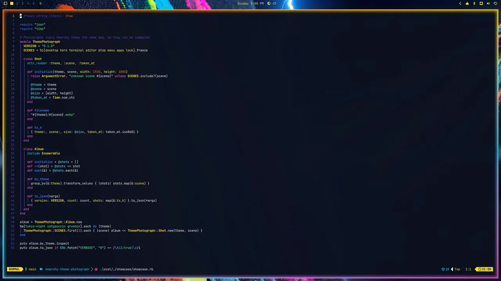
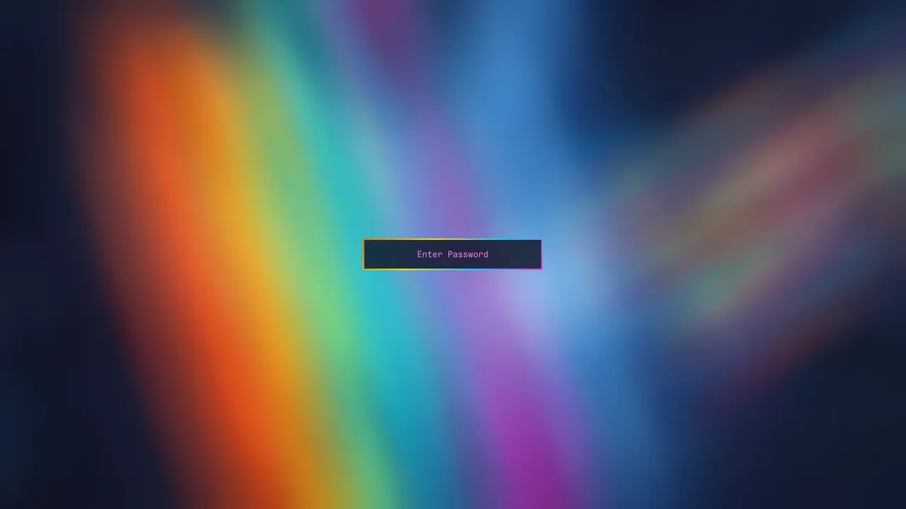
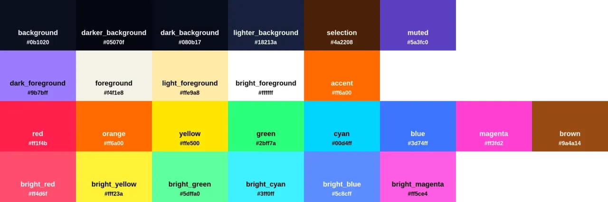
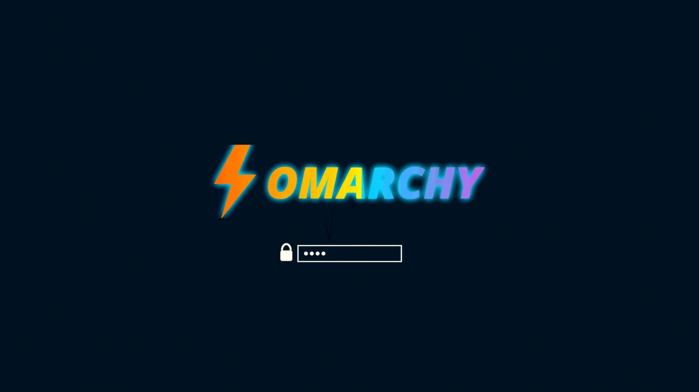
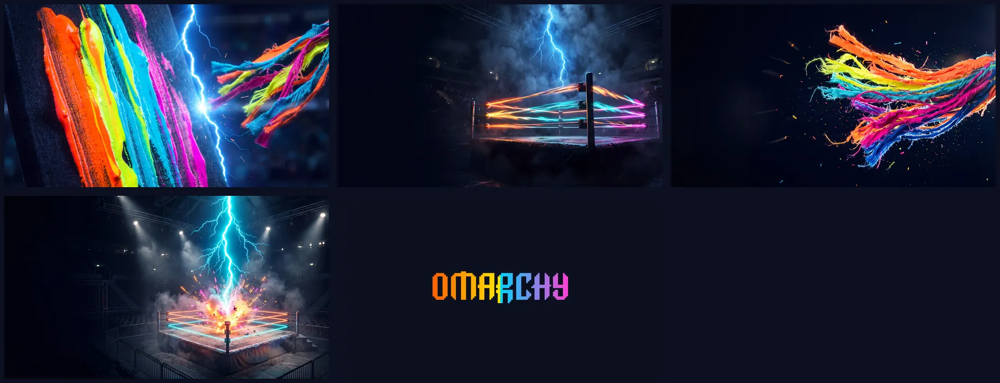

# Thunder Tassels

A full-volume neon Omarchy theme: rainbow tassels, war-paint orange and a lightning-struck ring.



Inspired by the face paint, neon tassels and lightning-bolt energy of 1980s pro-wrestling. A midnight-navy base lets every color hit at full voltage: the bar runs neon yellow, menus neon cyan, notifications neon green, and window borders sweep the whole rainbow.

## Install

```bash
omarchy theme install https://github.com/Gleasonmt/omarchy-thunder-tassels-theme
```

Or from the desktop: open the Omarchy menu → **Install** → **Style** → **Theme**, and paste the URL above.
The theme then shows up as **Thunder Tassels** in the theme switcher.

Update it with `omarchy theme update`, and remove it with `omarchy theme remove thunder-tassels`.

Requires Omarchy 4.

## Intro

Switching to Thunder Tassels with its first wallpaper plays a six-second intro: lightning cracks across the war paint three times before it settles on the wallpaper.



Turn intros on or off with `omarchy theme bg intro toggle`.

## Gallery

| Terminal | Neovim |
|:---:|:---:|
|  |  |
| **Lock screen** | **Palette** |
|  |  |

### Boot unlock screen

A rainbow OMARCHY wordmark with a lightning bolt. Choose it with `omarchy plymouth switcher`.



## Wallpapers

War Paint, Ring, Tassels, Lightning Ring and the Omarchy wordmark.



## Palette

| Role | Key | Color |
|---|---|---|
| Surfaces | `background` | `#0b1020` |
| Text | `foreground` | `#f4f1e8` |
| Accent | `accent` | `#ff6a00` |
| Selection | `selection` | `#4a2208` |
| Comments / dim text | `dark_foreground` | `#9b7bff` |
| Red | `red` | `#ff1f4b` |
| Orange | `orange` | `#ff6a00` |
| Yellow | `yellow` | `#ffe500` |
| Green | `green` | `#2bff7a` |
| Cyan | `cyan` | `#00d4ff` |
| Blue | `blue` | `#3d74ff` |
| Magenta | `magenta` | `#ff3fd2` |

Terminals, Neovim, btop, Hyprland borders and the rest of Omarchy are generated from `colors.toml`.
`shell.toml` sets the bar, menus, notifications and lock screen.

## What's included

- `colors.toml`, `shell.toml`, `btop.theme`: the palette and Omarchy shell styling
- `backgrounds/`: four original wallpapers, an Omarchy wordmark wallpaper, and an intro video in `backgrounds/intros/`
- `chromium.theme` and `icons.theme`: Chromium toolbar color and icon theme
- `unlock.png` and `preview-unlock.png`: boot unlock logo
- `keyboard.rgb`: RGB keyboard color for supported ASUS ROG and Framework 16 laptops
- `firefox/`: an optional matching Firefox theme. Load it from `about:debugging` → **This Firefox** → **Load Temporary Add-on** → `firefox/manifest.json`

## Credits

The wallpapers, intro video and unlock logo were created by the author for this theme.
The Omarchy wordmark comes from [Omarchy](https://github.com/omacom/omarchy) (MIT), recolored for this palette.
The unlock logo uses Noto Sans (SIL Open Font License).

## License

[MIT](LICENSE)
